# Loan Default Prediction



A hands-on machine learning project that predicts **the probability that a loan applicant will default**.
It follows one complete story, from raw data to a saved model that can score a new applicant:

**Understand → Clean → Prepare → Baseline → Improve → Package**

The notebook explains each step in plain language, with analogies, discussion questions and exercises.

## Project structure

```
loan-default-project/
├── Loan_Approval_Prediction_improved.ipynb   # the notebook (run this)
├── loan_features.py                          # custom feature engineering (created by the notebook)
├── requirements.txt                          # Python packages
├── README.md
├── .gitignore
└── data/                                     # NOT stored in Git (see "Get the data")
    ├── train.csv
    ├── test.csv
    ├── credit_risk_dataset.csv
    └── sample_submission.csv
```

Files the notebook creates (also not stored in Git): `model.pkl` and `lgbm_submission.csv`.

## Get the data

The data files are **not included in this repository**. They are large, and part of the data comes from a Kaggle competition, so please download it yourself and accept the terms there.

| File | Where to get it |
|---|---|
| `train.csv`, `test.csv`, `sample_submission.csv` | Kaggle, Playground Series, *Binary Classification with a Bank Loan Dataset* (competition `playground-series-s4e10`). Join the competition, then download from the **Data** tab. |
| `credit_risk_dataset.csv` | Kaggle, the public **Credit Risk Dataset** (the original data the competition was generated from). Check the dataset page for its license. |

Create a folder called `data` next to the notebook and put all four files inside it.

## Setup

You need **Python 3.9 or later** and **Git**.

### Windows (PowerShell)

```powershell
git clone https://github.com/NuhaKamal/loan-default-project.git
cd loan-default-project

python -m venv .venv
.venv\Scripts\Activate.ps1

python -m pip install --upgrade pip
pip install -r requirements.txt

python -m ipykernel install --user --name loan-venv --display-name "Python (loan-venv)"
jupyter lab
```

If PowerShell blocks the activation script, run `Set-ExecutionPolicy -Scope CurrentUser RemoteSigned` once and try again.

### macOS / Linux

```bash
git clone https://github.com/NuhaKamal/loan-default-project.git
cd loan-default-project

python3 -m venv .venv
source .venv/bin/activate

python -m pip install --upgrade pip
pip install -r requirements.txt

python -m ipykernel install --user --name loan-venv --display-name "Python (loan-venv)"
jupyter lab
```

## Run the notebook

1. Put the four CSV files in `data/` (see above).
2. Open `Loan_Approval_Prediction_improved.ipynb` in JupyterLab.
3. Choose the kernel **Python (loan-venv)**.
4. Check that the setup cell contains `DATA_DIR = Path("data")`.
5. Run the cells from top to bottom (**Kernel → Restart Kernel and Run All Cells**).

Quick check that the right environment is used:

```python
import sys
print(sys.executable)   # the path should contain .venv
```

## Notebook outline

| Section | Topic |
|---|---|
| 1 | Setup |
| 2 | Get the data |
| 3 | Clean the data |
| 4 | Explore the data (EDA) |
| 5 | Prepare the data (pipeline) |
| 6 | Split the data and set the floor (dummy model) |
| 7 | Baseline model: Logistic Regression |
| 8 | Feature importance (Random Forest) |
| 9 | LightGBM with Stratified K-Fold |
| 10 | Final model and submission |
| 11 | Save the model and score one applicant |
| 12 | Recap and exercises |

## Use the saved model

After running the notebook, `model.pkl` contains the whole pipeline (preprocessing + model):

```python
import joblib
import pandas as pd

model = joblib.load("model.pkl")

applicant = pd.DataFrame([{
    "person_age": 25, "person_income": 40000, "person_home_ownership": "RENT",
    "person_emp_length": 2.0, "loan_intent": "PERSONAL", "loan_grade": "C",
    "loan_amnt": 10000, "loan_int_rate": 13.5, "loan_percent_income": 0.25,
    "cb_person_default_on_file": "N", "cb_person_cred_hist_length": 3,
}])

print(model.predict_proba(applicant)[0, 1])   # probability of default
```

Keep `loan_features.py` in the same folder as `model.pkl`, and use the same library versions that were used to train it.

## Troubleshooting

| Problem | Fix |
|---|---|
| `ModuleNotFoundError: No module named 'numpy'` | The notebook is using the wrong kernel. Select **Python (loan-venv)** and make sure `pip install -r requirements.txt` ran inside the activated `.venv`. |
| `FileNotFoundError ... train.csv` | The CSV files are not in `data/`, or `DATA_DIR` is not `Path("data")`. |
| `ModuleNotFoundError: loan_features` | Run the cell that starts with `%%writefile loan_features.py` first. |
| Errors about `sparse_output` or `set_output` | Upgrade scikit-learn: `pip install -U scikit-learn`. |
| Seaborn `legend` error | Upgrade seaborn: `pip install -U seaborn`. |

## Notes

- The classes are imbalanced (most applicants repay), so the notebook relies on ROC-AUC, precision and recall rather than accuracy.
- The cost values used to choose a threshold (`COST_MISSED_DEFAULT`, `COST_REJECTED_GOOD`) are illustrative assumptions. Change them to match a real bank's costs.
- Age is dropped from the model. This is partly a statistical choice (it overlaps with credit history length) and partly a fairness discussion point: in many places, age is a sensitive attribute in lending decisions.
- This project is for learning. It is not a production credit-scoring system.

## Credits

Data: Kaggle Playground Series (Season 4, Episode 10) and the Credit Risk Dataset. Please follow the terms listed on each Kaggle page.
